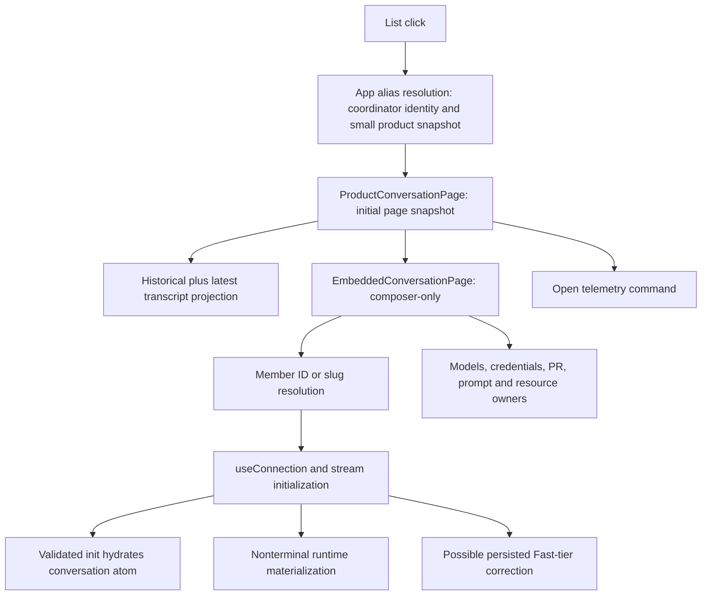

# Target conversation replay: dependency map and implementation seams

## Approved objective and boundary

The normal Phoenix binary, entry point, route table and production UI hydrate target ProductConversation `7c2d9446-46a1-42b4-bbad-c8ddfbfddf7f` from an immutable sanitized fixture without constructing execution authority. Calibrate against local production before agreeing repeated baseline samples. No optimization, continuation/recovery, mock-provider execution, durable-wake removal, general read-only coverage or Nono integration.

Standing rules: partial capability coverage is acceptable; parallel application behavior is not. Observation does not imply activation. Expected capability absence is ordinary and explicit. Commands cannot report successful effects that did not occur. Individual callers use specific capabilities, not a global read-only flag.

## Verified journey

`showTranscript=false` is a rendering choice, not absence of live dependencies. `mutationEnabled=false` suppresses the composer but does not prevent those dependencies from mounting. Aggregate Open lifecycle is not proof of execution capability.

## Dependency ledger

| Operation | Current owner | Classification | Required replay treatment |
|---|---|---|---|
| Auth/bootstrap status | App + auth handlers | Host observation; login writes persistent sessions | Truthful composition facts; no fake provider credentials; isolate/reject persistent session authority |
| Product/member/coordinator alias resolution | App, ConversationPage, route handlers | DB observation | Shared `ConversationRouteObservations`, preserve namespaces/errors/coordinator continuation membership |
| Initial/older product snapshots | ProductConversationPage + product_conversations helpers | DB read/projection | Same production SQL, cursors, metadata and serialization; retain request multiplicity for baseline |
| Member stream transcript selection | stream_conversation + stable_transcript_read | DB observation plus process-local cursor evidence | Extract shared initialization; do not substitute static init bytes |
| Live broadcaster/replay ring | RuntimeManager + SSE pipeline | Process-local observation | Preserve honest completeness/cursor semantics; DB-only capture cannot reproduce in-flight token evidence |
| Runtime materialization | stream_conversation calls get_or_create for nonterminal rows | Execution admission | Separate activation from observation; absent activation authority is never constructed/invoked |
| Fast-tier correction | stream_conversation | Persisted command | Keep normal path semantics; do not run in observation composition |
| Conversation enrichment | enrich_conversation_with_seed/runtime | Persisted metadata plus live browser/tmux/resource facts | Shared persisted projection with explicit optional observation sources; no invented defaults implying live success |
| Legacy active/archived lists | refresh driver, DesktopLayout, Sidebar | DB observation plus repeated live refresh | Preserve list workload for calibration; one-shot read and subscription/polling capabilities distinct |
| Models/helper/login | useModels, useAutoAuth, CredentialHelperPanel, Sidebar | Provider observation and credential execution | Not needed to display history; capability-aware owners without fabricated valid model |
| PR refresh/system prompt/work inventory | ConversationPage hooks | Persisted seed plus external/runtime observations | Retain persisted seed; unsupported observation explicitly unavailable; no git/provider/process work |
| Terminal/browser/file viewers | conditional/restored UI owners | Host/resource reads and execution | Specific capabilities at owners; restored UI cannot bypass absence |
| Notification settings | shell/settings owners | Observation plus mutation/browser effects | Specific settings/subscription capabilities; no accidental migration writes |
| Telemetry | Product open reporting and conversationOpenTelemetry | Optional command | Specific recording capability; local timing observers remain available |
| Send/cancel/approval/model/file actions | composer/WorkActions/task owners | Commands | UI unavailable and server admission rejects independently |
| Durable wake | optional obsolete status UI and startup worker | Separate producerless subsystem | Not part of replay journey; exclude execution machinery without extending/removing it here |

## Startup hazards

`run_server` performs work before `AppState::new`: writable migrations/settlement, worktree and project reconciliation, skills/companion writes, provider discovery, MCP setup and host probes. `AppState::new` performs close/continuation/wake settlement and starts workers, PR polling, attachment cleanup and retrieval reconciliation. Replay selection must precede these, not merely omit API keys or disable one runtime flag.

## Adversarial review outcome

An enum around only RuntimeManager is insufficient: AppState also owns providers, MCP, terminals, chains, credentials and writable DB. Making all those fields optional is rejected. The proposed next seam is an application envelope with shared observation services and a typed live dependency bundle, with fallible request extraction that rejects unavailable execution before body/upload/WebSocket handling. Keep a single route table. No Deref fallback that silently grants live authority in replay.

The request-composition seam is implemented: `ApplicationState` owns either the unchanged live `AppState` bundle or bounded observation services; `LiveState` rejects unavailable live authority before request bodies/upgrades. The normal route table is shared. Shared observations expose bounded methods, not writable pool/DB accessors. Auth middleware preserves the live path and admits observation only for direct loopback peers with no forwarding headers; no observation session store exists. Startup selection, shutdown and transcript service extraction remain pending; GET alone is not an observation classification.

## Implementation status

1. Route observations extracted from production handlers; immutable fixture tests plus normal HTTP route tests establish the initial read seam.
2. Request composition/admission implemented and tested without replay startup: immutable same-router reads, pre-body/multipart/unsafe-GET/WebSocket denial, peer/forwarding policy, unchanged fixture, plus normal password/cookie/bearer-lockout regressions. Early normal-binary startup selection is implemented and independently reviewed; shared transcript services remain next. The replay branch does not construct the live bundle.
3. Then: shared transcript initialization and persisted enrichment, preserving normal ring/cursor/subscribe-before-read semantics.
4. Coordinate UI capability callers with the current ProductConversationPage streaming-render owner before changing its interfaces.
5. Delete separate fake benchmark server and auxiliary responses only when replacement works through real application.
6. Correctness pilot, calibration report, then sample/reset/cache/budget check-in before baseline collection.

## Open verification work (engineering, not product choices)

- Validate frozen fixture init completeness without pretending in-flight runtime evidence is present.
- Inspect target state and fixture's normalization losses; no new production-derived copy without specific authority.
- Preserve large legacy list interference and account for changed DB physical layout/compression/backend profile.
- Cover full normal router's unsafe GETs, multipart and WebSocket admission; immutable DB failure alone is not an isolation proof.
- Cross-check normal stream regressions and token-render isolation; do not absorb peer UI fixes.

## Coordination

Global handed off shepherding with UI owner overlap at ProductConversationPage. Reply tools rejected both provided Global addresses (stable target not found; exact transcript prohibited as Coordinator chain). Report milestones in this conversation until a permitted routing target exists; this delivery failure is not a reason to stop approved work. Durable-wake removal belongs to separate user-driven work.

## Validation milestone: composition foundation

- Route observation commit: `76023ec169b42ee1e1568f694d4124a2601a3968`; two immutable observation tests and nine normal route tests passed, focused fmt/clippy passed, independent source review found no blocker.
- Asset containment correction: `7116d7a73`; eight asset tests passed, including raw traversal and symlink escapes. This inherited issue was a blocker for treating public assets as bounded observation reads. Canonical containment assumes a trusted owned UI directory, not hostile concurrent filesystem replacement.
- Request composition: six full-router tests passed (three immutable observation/admission tests and three live-auth regressions); fmt/clippy passed. The broader API run passed 676 tests and failed only the new test's incorrect share URL; corrected admission suite then passed. Run normal live fixture tests with `PHOENIX_DISCOVERY_ENABLED=false` to avoid unrelated host service probes. AppState workers in those live regressions operate on disposable in-memory state and isolated runtime directories.
- Both ast-grep rules accept current source and reject deliberately injected authority bypasses. They remain syntactic guardrails, not isolation proofs.
- Replay startup/browser hydration has NOT been delivered by this milestone. No new fixture capture, production mutation or optimization occurred. Old fixture-server removal is pending replacement.

## Resumable next slice at HEAD 364b86986

Approved implementation continues; no new design approval is required. Startup review identifies an additional early boundary: `main::parse_invocation` currently rejects unknown server flags, and `main` installs a fatal diagnostic hook before `run_server`. Replay selection must happen before inherited fatal-log configuration can write on startup errors, not merely before AppState. Prefer one explicit CLI form (`--observe-fixture ABSOLUTE_DB --target REFERENCE [--port PORT]`), no parallel environment authority and no fallback to Live on incomplete arguments.

Next bounded implementation:

1. Typed invocation selection; preserve existing live/migrate/suggest/sandbox/build-identity dispatch.
2. Move the existing standalone fixture validator out of load_benchmark via clipboard into a shared owner (do not duplicate). Read-only/regular/absolute/no-hardlink/no-sidecar checks remain. No new fixture capture.
3. Add validated typed target scope to bounded observations, using the actual ordinary product resolver and aggregate topology; do not cache a duplicate member set. Preserve ID versus slug namespaces; reject off-target/child/disconnected rows.
4. Normal-binary observation branch before logging/provider config/probes/recovery, using the SAME create_router. Supply ConnectInfo from a real loopback listener. No normal AppState construction, no dummy live dependencies.
5. Validate schema/read compatibility by the needed shared reads; fixture builder omits migration ledger rows, so MAX(version) is not a valid compatibility test. Do not migrate or promise historical compatibility.
6. Observation shutdown owns only listener/read services, not live runtime retirement or bash kill-tree; bounded SIGINT/SIGTERM drain, close DB after transport release.
7. Actual executable tests with marker-writing credential-helper and local network sentinel configurations verify that live initialization is never invoked; unchanged fixture/hash/sidecars, scope matrix and real ConnectInfo are required.

This intermediate server will still reject product snapshots, lists and streams until their shared observation service extraction lands. Do NOT claim browser hydration, delete the prior scaffold prematurely, or collect a benchmark from this intermediate milestone. Follow with shared transcript initialization/persisted enrichment, then coordinated UI capability callers, replacement/scaffold deletion and calibration check-in.

Review provenance: final corrected composition review approved tracked diff SHA-256 `7a0633bf43f8ca2cb2e5e09aa04d284ede1adfb60554f38ba2706355624b1454` against asset-fix HEAD `7116d7a73`; code committed as `4af6894f1`, contract/status committed as `364b86986`. The review explicitly excludes startup/SSE/UI/calibration claims.

## Functional milestone: normal-binary observation startup

The normal executable accepts one explicit intent: `--observe-fixture ABSOLUTE_DB --target REFERENCE [--port PORT]`, default port 8043. Selection happens before fatal diagnostic hooks and all live startup. The live `run_server` body is untouched. Observation opens a validated immutable file, preflights the actual scoped read services, serves the existing route table with real loopback ConnectInfo/compression, and performs bounded signal shutdown without live retirement/cleanup. It consumes no inherited live provider, password, TLS, bind, database or diagnostic configuration.

Route scope is a typed canonical ProductConversation identity, not a cached member set. Exact product-ID references use the aggregate canonical root in observation only; exact transcript/slug references must belong to the root's forward chain. This avoids admitting children/disconnected rows and avoids depending on the legacy resolver's lexical candidate selection. Normal resolution behavior is unchanged.

Current proof: 2 actual-normal-executable tests, 3 immutable observation tests, 4 invocation/parser tests, 6 full-router admission/live-auth regressions, 3 normal route regressions and 8 asset regressions passed; focused fmt/clippy passed. Executable tests use disposable synthetic fixtures without a migration ledger and intentionally enabled provider/helper/discovery/logging traps, checking no sentinel activity, immutable bytes/no sidecars, unrelated-reference denial, unavailable command/read admission, startup errors without live fallback and SIGINT/SIGTERM shutdown. Negative corrupted-topology fixtures explicitly remove relevant schema guards only during disposable test setup. The startup guardrail accepts the current source and rejects an injected `run_server` call.

The independent exact-source review approved the corrected startup slice. It did not independently run tests or approve hydration/UI/calibration. Source has a 5-second HTTP drain plus a separately bounded 5-second pool close; hanging-request stress coverage remains a limitation. A same-host proxy stripping all forwarding headers is outside the direct-loopback detection guarantee.

This is a real functional startup milestone, NOT a working conversation viewer: product snapshots/lists/member stream still return capability-unavailable until shared hydration is extracted. Do not point users at it as a benchmark. Old fake-server tooling remains only until replacement can load the target. No new fixture capture, production mutation/deployment or calibration choice occurred.

Next: promote shared product read/projection and persisted member hydration into bounded observations; separate stream activation/normalization from shared init and preserve subscribe-before-read, generation/cursor and final-message identity semantics. Existing fixture was normalized to Idle and omitted runtime obligations; prove sufficient settled observation evidence before claiming faithful stream replay. No fake process metadata, model availability or static SSE bytes. Then coordinate specific-capability UI callers and remove scaffold.

UI overlap warning: supplied peer hash `e8090e7ae61a3801979373738da3c4a0db68fb18` resolves in this checkout to Markdown disclosure-recovery changes, not the described coherent-transcript-finalization candidate. Obtain the actual interface/source identity through shepherding before editing ProductConversationPage; no UI changes have been made here.

## Shared hydration milestone: product detail and persisted transcript owner

- `cd2e80875`: the normal product-detail route uses `ConversationRouteObservations` in both compositions and delegates to the exact `read_product_conversation_snapshot` reader/projection. Live forwards the original reference/query unchanged. Scoped observation validates target and reachable member, preserving requested-member/cursor semantics; real snapshots now work over the actual normal binary. Product list remains live-only; no canned responses were introduced.
- Validation: 5 observation/parity/pagination tests, 28 normal product tests, 6 admission/live-auth tests and 2 normal-executable tests passed; fmt/clippy passed. Independent exact-source review approved three-file diff SHA-256 `e0b3f9178231b5e3405adc4861a6f0c65b4b14f4f97037b9bdbe03fba37317c7` against `89f74d0c4`.
- Calibration caveat: scoped validation performs additional resolver/topology reads before the production snapshot helper. This is real scope admission overhead absent from Live, not an optimization. Its request time must be separated from helper stage timing during calibration; do not infer production parity from replay wall time.
- `7cf659a68`: generation-stable transcript reading, render-unit alignment, bounded latest/before selection, stream DB selection/coverage and test generation-race hooks moved to a shared persisted observation owner. Latest/before bounded methods privately reference Database and enforce positive/clamped limits. Normal stream reservation/subscription, ring-before-durable read, generation retry, cursor selection and init floor ordering remain unchanged. No fake SSE events or metadata were added.
- Validation: 38 transcript tests, 15 stream tests, 4 message-history tests, fmt/clippy passed. Independent review approved behavior on source hashes `handlers.rs=166ed39a20c9bd2e12b95cef8174e6f7373bbacc39fea16b169f5df98dfc491c` and `transcript_observation.rs=14502f2335011ab55939ee07eabc0c8715591db92513ffdf0a3859da8417cab6`. Guardrail coverage was then extended to the new owner and tested: `TranscriptCoverage` data import allowed, injected `RuntimeManager` import rejected. The review's initially supplied abbreviated baseline was mistaken; actual baseline was `cd2e80875`, verified before commit.

Remaining stream-init seam: handlers still own activation/service-tier normalization, broadcaster/ring evidence, process-derived browser/tmux observations, conversation metadata and typed Init assembly. Next extract persisted enrichment and typed initialization with explicit process-evidence input, not a Runtime trait or fake live bundle. Keep normal subscribe-before-read and checkpoint/finality invariants; DB-only fixture normalization to Idle is not proof that all live in-flight evidence was captured. Use existing private fixture only; no new capture has been authorized. No unsupported metadata should be silently encoded as healthy/valid/live.

Peer UI clarification received: `e8090e7ae` is the tip of a four-commit candidate, not the single coherent-snapshot commit. The full `c5c33a53..e8090e7ae` range was inspected: early `18707e7cc` and `9365b3190` introduce coherent structural snapshots and request-matched streaming leaves/pending acknowledgment filtering; later Markdown disclosure corrections are expected. No cherry-pick or UI edits were made. Coordinate the candidate's publication/actual integrated source before touching ProductConversationPage; preserve leaf token isolation and final-message dedup contracts.

No new fixture capture, production changes, provider/tool execution, baseline sample choices or optimization occurred. The fake HTTP scaffold remains pending a correct shared member initialization/UI replacement. These are hydration-building milestones, not a calibrated baseline or completed replay.

## Member initialization evidence boundary: commits 58c86ab95 and 8cd89a914

`MemberObservations` owns persisted parent/seed/PR reads and projects explicit `MemberProcessObservations`; the normal wrapper gathers real shell/home/tmux/browser facts. Original sampling order is preserved: process basics, persisted PR/parent reads, resource resolution, browser activity. No unavailable replay facts are encoded as false/healthy. Four projection/parent/PR tests, 15 stream tests, 2 full-conversation generation tests, 5 cached-PR tests and 4 browser-session regressions passed; fmt/clippy passed. Independent source review found no behavior blocker. These new metadata tests use real in-memory databases and unchanged input assertions, NOT immutable-file isolation proof.

`member_initialization` separates private-field `PersistedTranscriptEvidence` from genuine `StreamEvidence` captured from an actual broadcaster. The shared assembler emits the same typed Init; normal handler retains subscription/reservation, ring-before-durable read, generation retry and observes the correct floor before metadata reads. Two tests compare wire bytes against the original assembly across Complete/Tail/Preserve with pending tokens/eager messages/current-cursor-empty/truncated rings and protect against allocated-but-unincluded sequence advancement. Fifteen normal stream regressions and final fmt/clippy passed. Independent source review found no behavioral blocker; later fixes were test-only API/lint corrections. Guardrails cover both new modules. No fake replay-source constructor exists.

### Precise remaining contract gap

The immutable fixture has durable rows, normalized Idle state and no captured process-local observation evidence. Shared live Init requires an incarnation/ring anchor/pending-event evidence plus process display facts. A DB-only observer must not satisfy those requirements by constructing an inert broadcaster, empty ring, valid model or false browser state. That would reintroduce the deleted-design failure.

The next earned slice is specific-capability bootstrap plus **persisted member observation**, with unavailable process-local capabilities represented explicitly and callers hydrating from that observation without claiming live stream connectivity. The alternative is capturing genuine process evidence, which requires new capture authority and is NOT authorized. The normal live Init path remains shared and unchanged; replay needs an honest persisted-source contract/adapter, not a successful static SSE response. If the existing wire cannot express unavailable fields, make the smallest typed contract change with Rust/codegen/schema/UI parity tests; do not silently introduce defaults or broad mode checks. Need coordinate actual UI candidate source before touching connection/hydration owners. This is the blocker to first real target browser journey, not a reason to manufacture evidence or enlarge into general simulation.

Calibration refinement from shepherd: admission pre-reads may warm SQLite/OS caches. Preserve end-to-end wall latency and measure actual admission/helper contributions with comparable boundaries. Subtracting admission wall time cannot establish cold/live equivalence. No assumed costs, cache reset or benchmark-budget choice is authorized by this milestone.

No new fixture capture, provider/tool execution, production changes, UI edits or calibration choices occurred. Old fake-server scaffold remains only until the honest target observation adapter replaces it; no completed replay or calibrated baseline is claimed.

## Local recovery validation — 2026-10-11

Retained owner successor `d6180a8a-3604-4981-bacd-d06d570a80df` continued the admitted dirty implementation at HEAD `41d94e3ca334030b4ef859d80b78025f10375bdb`. Runtime database inspection confirmed `gpt-6.1-sol`, null effort, standard tier, `detached_product_creation`, and WorkScope `6fb349c6-4ce7-496a-96a0-ee5dbee760f7`. No staging, reset, stash, remote execution, replacement writer, merge, deployment, fixture capture, or benchmark/calibration run occurred.

Completed source corrections:
- Work identity disables the PR-status hook when `host_resource_observations` is unavailable; durable work identity remains displayed.
- ProductConversation mounts the real persisted current-member owner without live execution controls or a second transcript renderer. Its metadata-only mount does not inherit full-view sizing.
- App-level regressions exercise the real public SharePage/MessageList without owner auth/capabilities, share-to-owner authentication, pending/invalid capabilities, and direct `/new` activation absence.

Fresh validation:
- `./dev.py check --lanes tsc,ui-lint,vitest`: all four checks passed (`/tmp/recovery-ui-latest.log`). An earlier full run had one product fixture timeout; its complete module passed in isolation before the final full suite passed. No test was removed or relaxed to conceal that result.
- Current-source application-state tests: 10 passed. Persisted-member export tests: 6 passed. Actual executable startup suite: 2 passed (`/tmp/recovery-startup-module.log`). An earlier negative-startup run accepted a connection on its discovery-range sentinel; the exact test and then the complete suite passed on rerun. Connection origin was not established, so the transient is retained as unresolved evidence rather than attributed to an external process.
- Existing owner tmux window `@8` was reused to rebuild/start the normal binary on `127.0.0.1:18043`. Unknown port 8044 ownership was untouched.
- Fresh real list click reached `/c/7c2d9446-46a1-42b4-bbad-c8ddfbfddf7f`; actual current member `/api/conversations/bf738a43-e882-4b3b-a74e-8c8cb56d0e63/observation` returned 200. All six API resource entries returned 200; no PR-status, EventSource, provider-catalog, telemetry, or command request appeared. Tail `f95aaedb-5f8b-437d-a446-9238de1f854a`, sequence 1499, had meaningful visible content; transcript scroll top 11022, height 11661, client 638, bottom gap 1px. Input was absent and the status explicitly reported live connection/user-input unavailability.
- Real direct `/new` showed creation unavailable with no textarea and only auth/status + capabilities API entries (both 200). Two navigation-tool calls timed out although the resulting document reported complete and the required UI was subsequently verified. This is not a calibrated timing result.

Still incomplete: removal of superseded fixed-response server/auxiliary generator, truthful replay scenario readiness, fresh generated-byte parity/broad repository validation, exact-source adversarial review, and scoped delivery. No performance improvement, combined #888/#889 qualification, or benchmark budget acceptance is claimed. Their separate owners and integration caveats remain unchanged.

## Functioning replay finish — 2026-10-11

The fixed-response `load_benchmark` binary/module and auxiliary static-response generator are retired. The normal `phoenix_ide` serve path and existing sanitizer remain. Obsolete fake-router/static-init regressions are explicitly mapped to normal-router immutable read/admission/startup tests and no-aux/current-member/readiness Python regressions in `docs/conversation-load-benchmark.md`; no regression was silently dropped. Scenario readiness requires persisted-member hydration, unavailable live/input status, absent textarea, meaningful visible exact tail, nonzero transcript height and correct bottom anchor. Scenario generation was checked without executing a performance sample.

Evidence retained privately in `.phoenix/replay-proof/` includes the original browser tracked-source patch/source manifest, exact review-source archive, loaded binary/asset/fixture hashes, final binary/asset hashes, generated scenario and test/failure logs. Fixture hash remains `13f53c154a9af5d3e94e13fd4feb1c54af7d75d370c54faaed225ab3e7125308`. Final normal binary hash is `4b3677d4fdda6fc92b737d19f70c63e08ca1a97fc25b3e5e5343e09f880d4096`; main UI asset hash is `4d4a1931a528d9d2991f3d718216be8d889e78e05f861e980c94b92a8b045caa` (`index-4hlwii8y.js`). Owner window `@8` was reused, listener PID 75269 on 18043. Fresh final-binary real click reproduced the six 200s, persisted current-member hydration, meaningful visible sequence1499 and 1px bottom gap. Actual PageUp moved scroll top11022→10424; PageDown restored11022 and 1px gap without input or API effects. This was functional exercise, not timed calibration.

Bounded sentinel investigation: the test listens on host-global discovery range9000–9099; normal debug Phoenix discovery probes that range on127.0.0.1. Child `env_clear()` and disposable filesystem paths do not isolate host loopback clients. A single 65-second-budget ambient-only probe (no replay child launched by that probe) received a connection after39.724s; contemporaneous lsof attributed its client socket to existing Phoenix PID86115. The request prefix was `GET /.well-known/api-catalog` with `User-Agent: phoenix-ide-local-discovery`. This reproduces an attribution weakness, not the original connection's identity. The original failure remains unresolved as to peer origin. Startup assertions still reject all sentinel connections and now capture bounded address/peer/request-prefix diagnostics; no ignore/skip/filter was introduced. Existing child-exit polling uses reaped status as its oracle, with explicit lint exceptions and only an outer liveness deadline.

Qualification:
- Python sanitizer/readiness suite:17 passed (`/tmp/replay-python-final.log`). Only disposable unit-test fixtures were generated; no source capture occurred.
- Fresh broad `./dev.py check --compiler-cache none`: codegen and scratch-byte stale check passed, as did full UI, fmt, task, ast-grep, manual SQL, anchors, package-lock and e2e. Rust fail-fast stopped after2287 tests (2286 passed,1 unrelated failure;2378 not run). Replay-owned clippy/test-timing/ADR-shape issues discovered in that run were fixed and requalified, not suppressed.
- Final `./dev.py check --lanes cargo-fmt,clippy,spec-shape,spec-anchors,ast-grep --compiler-cache none`: all8 checks passed, including clippy, process-poll timing lint, dev.py unit tests and spec shape (`/tmp/replay-clippy-final.log`).
- Entire owning crate with no fail-fast:1828 passed,124 filtered/skipped; includes both actual-executable startup tests, normal live auth/SSE/projection and persisted admission/hydration tests (`/tmp/replay-owning-crate-final.log`). No repeated startup-search loop was used.
- Independent full frozen-snapshot review: no actionable findings, static limits. Base HEAD `41d94e3ca334030b4ef859d80b78025f10375bdb`; initial patch hash `e3d326ae64335defa8f7ef6226c3476625460dc8075fe039441e64cf7841bc8c`. Final bounded delta review also found no actionable findings and verified patch hash `3104da7f7fa37f59a845b63d5354dad707ca2c519d6e05986702af0f647e6d26`, source-manifest hash `4fef177d453dd2b4d643fa100f5487138528f82bc65ef629ed978a514bf0a088`, including untracked source bytes and explicit deleted paths. These are working-snapshot reviews, not a combined-PR or hosted reviewer receipt.

Unrelated blocking TODOs retained, not fixed or blessed:
- Unchanged `phoenix-tools::bash::registry::tests::cascade_bash_on_delete_records_live_pgids_and_drops_entry` expects2 reported synthetic PGIDs and receives1. Exact test and full registry module both reproduce it (module37 passed,1 failed); source is byte-unchanged from HEAD. Logs `/tmp/replay-unrelated-bash-isolated.log` and `/tmp/replay-unrelated-bash-module.log`. This blocks a repository-wide green Rust claim, not the completed owning-crate result.
- Unchanged Allium parser errors in `specs/llm/{anthropic,chat-completions,responses}.allium` remain broad-check blockers. No unrelated spec cleanup was folded into replay.

No all-green repository claim, optimization, production-equivalence assertion or calibration sample is made. The calibration decision packet is in `docs/conversation-load-benchmark.md`: comparison/fidelity boundary, build/browser identity, cache/concurrent-workload policy, sample/warmup/GC/throttle budgets and error/readiness criteria require user/Global decision. #888 LiveState load-endpoint/live-only collector+UI construction, ADR092 collision and combined tests remain pending; held #889 parser changes were not imported. No merge/deploy or remote execution occurred.
