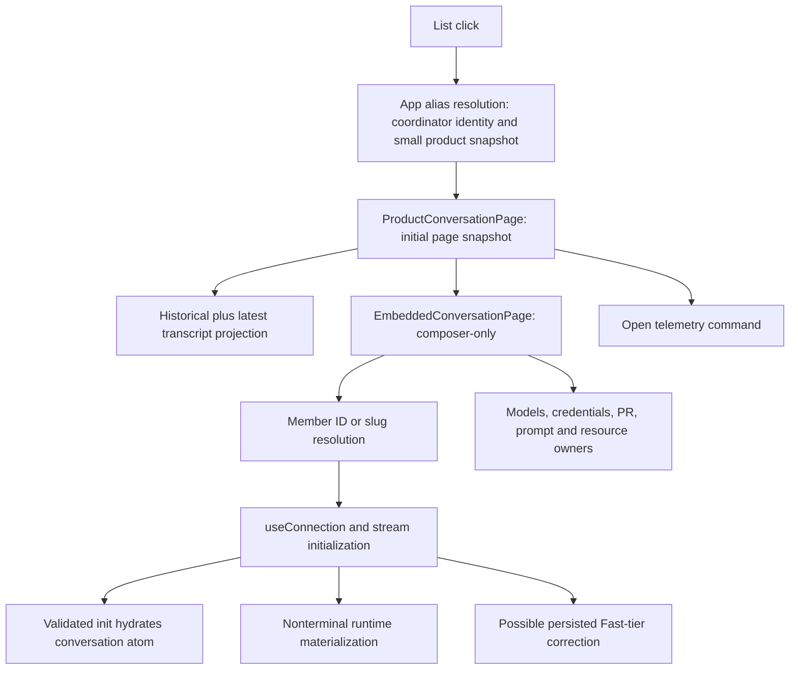

# Target conversation replay: dependency map and implementation seams

## Approved objective and boundary

The normal Phoenix binary, entry point, route table and production UI hydrate target ProductConversation `7c2d9446-46a1-42b4-bbad-c8ddfbfddf7f` from an immutable sanitized fixture without constructing execution authority. Calibrate against local production before agreeing repeated baseline samples. No optimization, continuation/recovery, mock-provider execution, durable-wake removal, general read-only coverage or Nono integration.

Standing rules: partial capability coverage is acceptable; parallel application behavior is not. Observation does not imply activation. Expected capability absence is ordinary and explicit. Commands cannot report successful effects that did not occur. Individual callers use specific capabilities, not a global read-only flag.

## Verified journey

`showTranscript=false` is a rendering choice, not absence of live dependencies. `mutationEnabled=false` suppresses the composer but does not prevent those dependencies from mounting. Aggregate Open lifecycle is not proof of execution capability.

## Dependency ledger

| Operation | Current owner | Classification | Required replay treatment |
|---|---|---|---|
| Auth/bootstrap status | App + auth handlers | Host observation; login writes persistent sessions | Truthful composition facts; no fake provider credentials; isolate/reject persistent session authority |
| Product/member/coordinator alias resolution | App, ConversationPage, route handlers | DB observation | Shared `ConversationRouteObservations`, preserve namespaces/errors/coordinator continuation membership |
| Initial/older product snapshots | ProductConversationPage + product_conversations helpers | DB read/projection | Same production SQL, cursors, metadata and serialization; retain request multiplicity for baseline |
| Member stream transcript selection | stream_conversation + stable_transcript_read | DB observation plus process-local cursor evidence | Extract shared initialization; do not substitute static init bytes |
| Live broadcaster/replay ring | RuntimeManager + SSE pipeline | Process-local observation | Preserve honest completeness/cursor semantics; DB-only capture cannot reproduce in-flight token evidence |
| Runtime materialization | stream_conversation calls get_or_create for nonterminal rows | Execution admission | Separate activation from observation; absent activation authority is never constructed/invoked |
| Fast-tier correction | stream_conversation | Persisted command | Keep normal path semantics; do not run in observation composition |
| Conversation enrichment | enrich_conversation_with_seed/runtime | Persisted metadata plus live browser/tmux/resource facts | Shared persisted projection with explicit optional observation sources; no invented defaults implying live success |
| Legacy active/archived lists | refresh driver, DesktopLayout, Sidebar | DB observation plus repeated live refresh | Preserve list workload for calibration; one-shot read and subscription/polling capabilities distinct |
| Models/helper/login | useModels, useAutoAuth, CredentialHelperPanel, Sidebar | Provider observation and credential execution | Not needed to display history; capability-aware owners without fabricated valid model |
| PR refresh/system prompt/work inventory | ConversationPage hooks | Persisted seed plus external/runtime observations | Retain persisted seed; unsupported observation explicitly unavailable; no git/provider/process work |
| Terminal/browser/file viewers | conditional/restored UI owners | Host/resource reads and execution | Specific capabilities at owners; restored UI cannot bypass absence |
| Notification settings | shell/settings owners | Observation plus mutation/browser effects | Specific settings/subscription capabilities; no accidental migration writes |
| Telemetry | Product open reporting and conversationOpenTelemetry | Optional command | Specific recording capability; local timing observers remain available |
| Send/cancel/approval/model/file actions | composer/WorkActions/task owners | Commands | UI unavailable and server admission rejects independently |
| Durable wake | optional obsolete status UI and startup worker | Separate producerless subsystem | Not part of replay journey; exclude execution machinery without extending/removing it here |

## Startup hazards

`run_server` performs work before `AppState::new`: writable migrations/settlement, worktree and project reconciliation, skills/companion writes, provider discovery, MCP setup and host probes. `AppState::new` performs close/continuation/wake settlement and starts workers, PR polling, attachment cleanup and retrieval reconciliation. Replay selection must precede these, not merely omit API keys or disable one runtime flag.

## Adversarial review outcome

An enum around only RuntimeManager is insufficient: AppState also owns providers, MCP, terminals, chains, credentials and writable DB. Making all those fields optional is rejected. The proposed next seam is an application envelope with shared observation services and a typed live dependency bundle, with fallible request extraction that rejects unavailable execution before body/upload/WebSocket handling. Keep a single route table. No Deref fallback that silently grants live authority in replay.

The request-composition seam is implemented: `ApplicationState` owns either the unchanged live `AppState` bundle or bounded observation services; `LiveState` rejects unavailable live authority before request bodies/upgrades. The normal route table is shared. Shared observations expose bounded methods, not writable pool/DB accessors. Auth middleware preserves the live path and admits observation only for direct loopback peers with no forwarding headers; no observation session store exists. Startup selection, shutdown and transcript service extraction remain pending; GET alone is not an observation classification.

## Implementation status

1. Route observations extracted from production handlers; immutable fixture tests plus normal HTTP route tests establish the initial read seam.
2. Request composition/admission implemented and tested without replay startup: immutable same-router reads, pre-body/multipart/unsafe-GET/WebSocket denial, peer/forwarding policy, unchanged fixture, plus normal password/cookie/bearer-lockout regressions. Next: early normal-binary startup selection and shared transcript services; do not construct the live bundle in replay.
3. Then: shared transcript initialization and persisted enrichment, preserving normal ring/cursor/subscribe-before-read semantics.
4. Coordinate UI capability callers with the current ProductConversationPage streaming-render owner before changing its interfaces.
5. Delete separate fake benchmark server and auxiliary responses only when replacement works through real application.
6. Correctness pilot, calibration report, then sample/reset/cache/budget check-in before baseline collection.

## Open verification work (engineering, not product choices)

- Validate frozen fixture init completeness without pretending in-flight runtime evidence is present.
- Inspect target state and fixture's normalization losses; no new production-derived copy without specific authority.
- Preserve large legacy list interference and account for changed DB physical layout/compression/backend profile.
- Cover full normal router's unsafe GETs, multipart and WebSocket admission; immutable DB failure alone is not an isolation proof.
- Cross-check normal stream regressions and token-render isolation; do not absorb peer UI fixes.

## Coordination

Global handed off shepherding with UI owner overlap at ProductConversationPage. Reply tools rejected both provided Global addresses (stable target not found; exact transcript prohibited as Coordinator chain). Report milestones in this conversation until a permitted routing target exists; this delivery failure is not a reason to stop approved work. Durable-wake removal belongs to separate user-driven work.

## Validation milestone: composition foundation

- Route observation commit: `76023ec169b42ee1e1568f694d4124a2601a3968`; two immutable observation tests and nine normal route tests passed, focused fmt/clippy passed, independent source review found no blocker.
- Asset containment correction: `7116d7a73`; eight asset tests passed, including raw traversal and symlink escapes. This inherited issue was a blocker for treating public assets as bounded observation reads. Canonical containment assumes a trusted owned UI directory, not hostile concurrent filesystem replacement.
- Request composition: six full-router tests passed (three immutable observation/admission tests and three live-auth regressions); fmt/clippy passed. The broader API run passed 676 tests and failed only the new test's incorrect share URL; corrected admission suite then passed. Run normal live fixture tests with `PHOENIX_DISCOVERY_ENABLED=false` to avoid unrelated host service probes. AppState workers in those live regressions operate on disposable in-memory state and isolated runtime directories.
- Both ast-grep rules accept current source and reject deliberately injected authority bypasses. They remain syntactic guardrails, not isolation proofs.
- Replay startup/browser hydration has NOT been delivered by this milestone. No new fixture capture, production mutation or optimization occurred. Old fixture-server removal is pending replacement.
