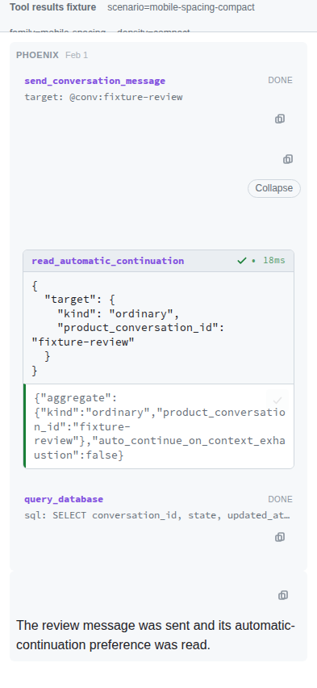
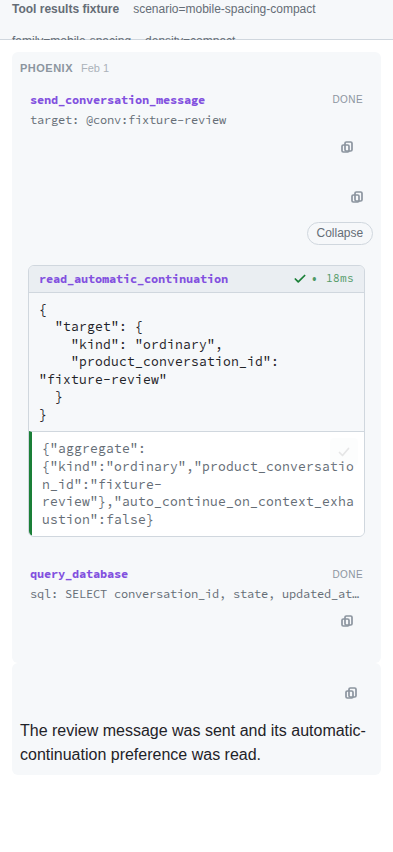

# Expanded mobile tool spacing

Synthetic, public component evidence for PR #1081. The original private user screenshot was inspected through the authenticated message API but is **not** included here.

## Failure and bounded correction

An expanded compact-tool selection embeds a non-first `AgentMessage` with message-copy controls suppressed. Its otherwise-empty continuation toolbar still occupied 44 CSS pixels on touch layouts. The selected-detail renderer now omits that empty toolbar; ordinary continuation toolbars and first-message metadata are unchanged. Existing owner-copy rows, copy buttons, collapse controls, tool arguments and results are retained. This removes one demonstrated redundant gap, not every region of whitespace or every mobile padding issue.

The reported screenshot selects `read_automatic_continuation` beneath a collapsed `send_conversation_message`, followed by `query_database`. This fixture uses that ordering and selection with invented, non-private values and the native preference-read contract (`aggregate`, `auto_continue_on_context_exhaustion`). The harness additionally expands the send and database tools.

## Provenance

- Source: `024c3eec2defc775ad2b3f883742b65267be8f63`.
- Hosted Chromium run: [43608760260](https://github.com/scottopell/phoenix-ide/actions/runs/43608760260), successful.
- Scenario: `mobile-spacing-compact`, real historical grouping and production tool renderer in the Ladle fixture shell.
- Before/control: same source, fixture and browser, with exactly the new selected-tool chrome predicate temporarily replaced by `true` in the hosted workflow. This restores the old unconditional chrome behavior; it is not a screenshot of an older release. An EXIT trap restores the source before the after capture.
- After: unmodified source at the SHA above. PNGs were visually inspected at all three widths.

## Measured results

The gap is the first tool content's top minus its embedded message's top, retaining the normal 14px message inset.

| Viewport | Before gap | After gap | Page width / scroll width after |
| --- | ---: | ---: | ---: |
| Touch 393 × 852 | 58px | 14px | 393 / 393px |
| Touch 320 × 760 | 58px | 14px | 320 / 320px |
| Desktop 1280 × 900 | 14px | 14px | 1280 / 1280px |

Each `*-before.png` / `*-after.png` has corresponding `.geometry.json` evidence, including complete synthetic preference arguments/results and copied output. Desktop chrome was already hidden by CSS, so its removal does not change the desktop gap.

| 393px before | 393px after |
| --- | --- |
|  |  |

## Checks exercised

- Expanded send input retains target, message and message ID; clipboard contains the complete structured input.
- Structured delivery result remains visible; subsequent tool cards remain present.
- Expanded preference input/result fields render and its output copies as parseable JSON with the original aggregate and preference.
- Generic database output copies with its row and state intact.
- Send collapse/reopen preserves content height within 1px; collapse retains the following tools.
- Fixed content inset is at most 16px (14px plus 2px tolerance); the touch before-control must reproduce at least 44px of gap.
- No horizontal page overflow at any captured viewport.
- Component regressions retain owner/tool copy controls and ordinary continuation chrome. The existing streaming/finalized chrome parity suite remains applicable.

## Limits

This is component-level desktop Chromium with touch-capable mobile viewports, not a physical iPhone, iOS Safari, installed PWA, keyboard, full-app scroll anchoring, or live automatic-continuation qualification. Static preference-read data does not exercise continuation runtime behavior. No original private transcript data or screenshot is published. No local Rust/native build, local dependency installation, production restart, merge or deployment was performed by this work. General hosted CI may build Rust as part of its normal checks.
