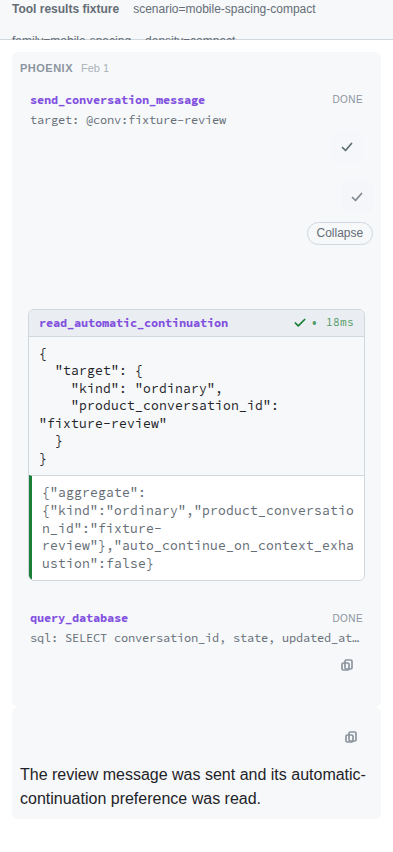
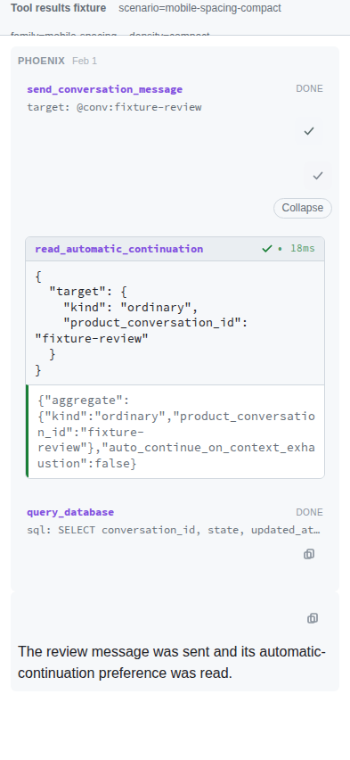

# Original screenshot acceptance reconciliation

## What the reported image shows

The private original was recovered through the authenticated message-range API and visually inspected independently by two reviewers. It is not copied into this repository. It shows a **collapsed send tool**, two right-aligned message-copy controls, Collapse, then the **expanded preference-read tool**, with its arguments and result visibly present, followed by a collapsed database tool. The send input/result are not supposed to occupy the collapsed card's preview area.

The originally reported raster landmarks (send summary near y500, copy controls y580/y730, Collapse y840, preference header y1070) span roughly 190 CSS pixels at the image's apparent 3× scale. Those are approximate image landmarks, **not original-device DOM measurements**. The reproduction uses the same ordering, selection and production historical grouping, with synthetic text and current native preference fields.

## The whole stack, not just the embedded inset

The [before](mobile-before.png) and [after](mobile-after.png) PNGs show the **entire stacked tool group** at 393px, including both copy rows, Collapse, expanded input/result, the following database card and final prose. Their 320px and desktop equivalents are also retained. They are not cropped preference-card inset images. The controlled before restores only unconditional chrome; all data, controls and other styles are identical.

The supplementary integration-tree pair below preserves the original qualified screenshots above and additionally exercises both owner-copy controls (checkmarks show successful copy actions).

| Full stack: empty-toolbar control on integrated main | Full stack: fixed integrated main |
| --- | --- |
|  |  |

In the matched 393px and 320px touch reproduction, the span from the **collapsed send summary's bottom to the expanded preference tool-block's top** is **180.953→136.953 CSS pixels**. Thus the fix removes 44px, approximately 24% of this full span. It does **not** make the two message-copy rows or Collapse disappear. Desktop's corresponding span remains 56.359px.

Positions below are relative to the tool group's top. Both touch widths produce the same vertical positions. Boundary rounding is to three decimals; source geometry retains full precision.

| Region corresponding to original image | Before/control | After | Ownership and classification |
| --- | ---: | ---: | --- |
| Send summary ends | 75.688 | 75.688 | A one-line collapsed preview, not full arguments/results. |
| Summary → first copy row | 3px gap, then row 78.688–110.688 (32px) | Same | `CompactToolStrip` renders the **send message owner's copy button** below its card preview. Blank horizontal area is a right-aligned control row; no invisible text node or missing tool body occupies it. |
| First row → second row | 18px separation; second row 128.688–160.688 (32px) | Same | First owner's row margin/card bottom padding/border plus strip/detail spacing, followed by the **selected preference message owner's copy button**. These are separate message owners, not two accidental copies of one item. |
| Second copy row → Collapse | 9.594px separation; Collapse 170.281–193.047 (22.766px) | Same | Existing row bottom margin plus selected-detail flex gap; Collapse is a real, separate control. It is not a placeholder for a hidden result. |
| Collapse → embedded message | 5.594px flex gap; message starts 198.641 | Same | Selected-detail layout spacing. |
| Embedded message → preference tool | 58px: tool starts 256.641 | **14px: tool starts 212.641** | **Actual defect:** the copy-suppressed, non-first embedded message rendered an empty continuation toolbar with 44px mobile min-height. Removing that no-content/no-action element retains the normal message/tool inset. |
| Preference header → arguments/result → next card | Complete argument/result panels visible | Complete panels visible, shifted up 44px | No clipping or missing preference content; no extra hidden-content correction was demonstrated. |

The retained 136.953px comprises **86.766px of actual control rows/buttons** (32 + 32 + 22.766) and **50.188px of card/control/inset spacing**, including the normal 14px embedded content inset. These are existing layout allocations, not readable prose. Calling them existing control spacing is not a claim that the layout is maximally compact or that the original user endorsed it. The source/DOM evidence distinguishes them from the single empty toolbar that had no consumer.

## Source rationale and acceptance conclusion

- `CompactToolStrip` emits an owner-copy row once for each message owner represented by its compact cards. `getToolOnlyMessageCopy` serializes that owner's tool call(s).
- `ToolOnlyAgentTurnGroup` places the selected tool between preceding/following strips. When that selected owner has no remaining compact card, it emits that owner's copy row, then Collapse, then its filtered `AgentMessage`.
- The embedded message uses `forceExpandedTools`, `visibleToolUseId`, `suppressMessageCopy`, and `isFirstInTurn={false}`. Before the fix, `AssistantMessageChrome` had neither first-message metadata nor unsuppressed actions, but its continuation toolbar still reserved mobile height.
- The fix omits only this empty selected-message chrome. It does not remove `.message-content`, tool input/output, annotation owner attributes or copy/collapse controls. Ordinary/streaming message chrome and first-message metadata remain.
- Card padding/gaps and the mobile `.message-mobile-copy-row` rules explain the unchanged regions. These are independently measured with class names and computed styles in `*-stack.geometry.json`, rather than inferred solely from the image.

**Acceptance recommendation:** the screenshot's demonstrated no-content/no-control padding defect is addressed. The remaining visual area is accounted for by preserved controls and their existing layout, not hidden/blank tool content. No additional product correction is justified by this screenshot without changing the compact-control layout itself; this reconciliation does not silently expand the fix into that redesign. The earlier claim is narrowed explicitly: remove the redundant empty toolbar, not eliminate all 190px or restore supposedly missing send/preference data.

## Merge-tree and commenting verification

The hosted qualification now fetches the actual current PR-base ref, materializes its non-committing merge with the PR head, records both base SHA and `git write-tree` ID, and runs the captures and targeted tests on **that resulting tree**. This is stronger than only checking that three files have no direct diff. The prior qualified source and evidence are preserved.

For source `197a3d99e56d863946529455cc4ddddec54fafaa`, hosted [run 43612965497](https://github.com/scottopell/phoenix-ide/actions/runs/43612965497) records main `9a286451f05d882e831f069bb762bc471ec5314a` and merge tree `93e0cad265dd7f7d690523affd8f4671389c81a1`. Independent local `git merge-tree --write-tree` produced the identical tree without modifying the checkout. TypeScript checking and **309 tests across eight focused files** passed on that tree: MessageComponents, AssistantMessageChrome, InlineMessageReaction, ReactionPill, DraftAnnotationCards, InputArea, AnnotationDraftStore and tool-results fixture contracts. Matched stack captures and clipboard/collapse checks also passed.

The commenting changes on this main do not edit the chrome-removal hunk, but they share rendered message/selection boundaries. `readReactionSelection` only accepts `.agent-text-block` prose under an owned message inside `#messages`; it excludes tool-block and compact-strip ranges. The retained message/fragment wrappers are outside the omitted toolbar. The focused suites cover comment append, pending selection/source return, annotation edit/delete/focus, edited-comment submission and in-flight draft isolation. A further direct regression checks that expanded tool arguments remain ineligible while adjacent prose retains its message/fragment annotation anchor after empty-chrome removal. A mobile capture also checks the two retained copy rows copy **different message owners**.

The supplementary stack JSONs and integration PNGs here come from source `ccf7fe578041b5aa70ad93db019144a2dac9c46e`, hosted [run 43613337588](https://github.com/scottopell/phoenix-ide/actions/runs/43613337588): main `9a286451f05d882e831f069bb762bc471ec5314a`, merge tree `57d68a002420baa638af8cd73c47285f91f4d78a` (also independently reproduced locally), typecheck and **310 focused tests passing**. The extra direct annotation-boundary regression and both distinct-owner clipboard assertions passed. All three viewport stack JSON pairs include complete computed layout and, on touch layouts, the copied synthetic owner contents.

Exact-final successor checks and source/tree IDs are recorded in the PR integration receipt; this file does not pretend the earlier run exercised a later tree. Neither the non-committing test merge nor this evidence merges or deploys the PR.

## Limits

The original private screenshot has no retrievable DOM geometry, so pixel-to-CSS mapping is approximate. Matched geometry and interactions are measured in hosted Chromium touch viewports inside the production-renderer fixture shell; they do not claim physical iOS, PWA keyboard, full-app scroll anchoring, or live continuation runtime qualification. No such gate is being introduced for this concrete screenshot reconciliation.
