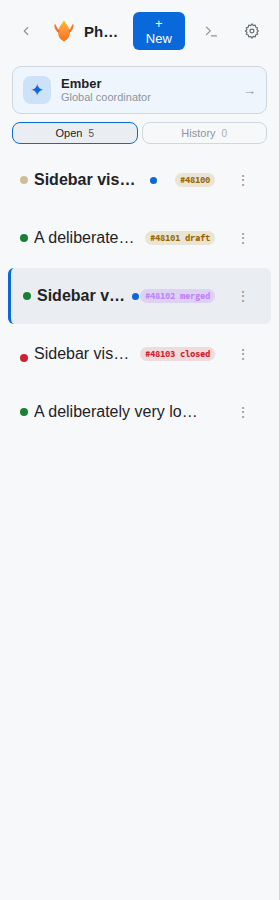
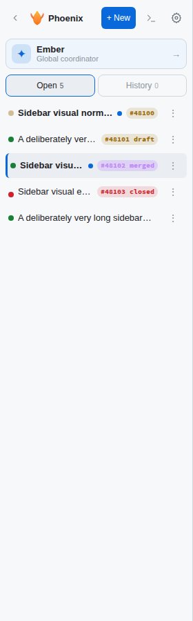
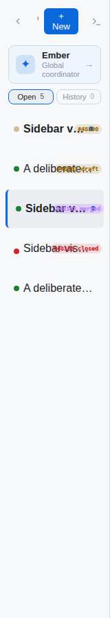
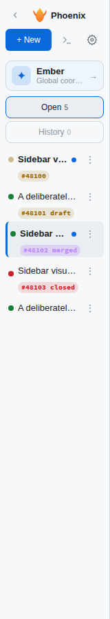
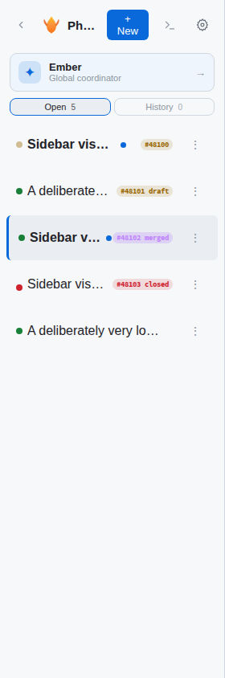
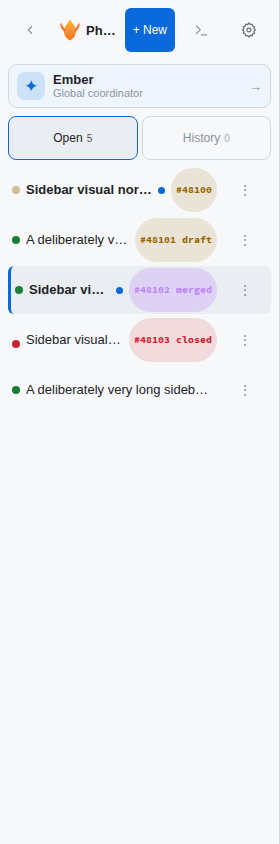
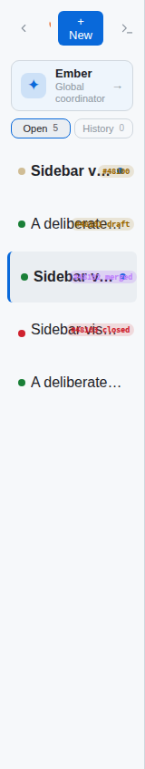
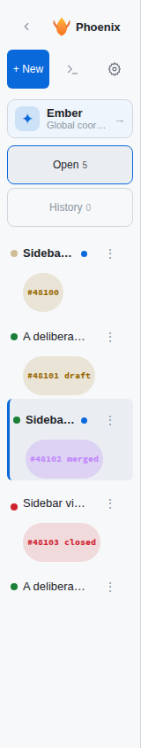

# Conversation sidebar visual density

Synthetic qualification for [PR #1094](https://github.com/scottopell/phoenix-ide/pull/1094). No production conversations or private screenshots are included.

## Provenance

- Captured source: `5c0d285e82c9982dab7aa796b0358836dfaf7973`, including hydration PR #1095 merge `e74907481402ddce1a837a08488dc2eeb8866d20`.
- Passing hosted run: [43796705673](https://github.com/scottopell/phoenix-ide/actions/runs/43796705673). Chromium, light theme, DPR 1; desktop 1180×900 with fine pointer, touch-emulated 390×844 with coarse pointer. These are not physical-device results.
- Same current Sidebar DOM, synthetic data, active merged/unread row, and capture harness in all three phases. `before/` substitutes CSS from `6cebf545fe6d16ed02c134a873ab254fea3ad29b` (unchanged for the relevant files at hydration merge). `rc6/` substitutes historic CSS from `bccfd66b2470a86910b952f22ccf327ed2c78f2f`; it is a historical CSS reconstruction, **not** an execution of the historical app or independently verified production deployment.
- `after/` contains product CSS from the captured source. Later fixture type narrowing, stylesheet rule ordering, and effective TypeScript project checking are qualified separately by the PR's final-head checks; these files retain their original capture identity.
- `normal` means a 280px sidebar pane; `narrow` means the supported 160px pane. Viewport dimensions do not imply pane dimensions. The original reported screenshot's zoom and CSS dimensions are unknown.

## Before / after

| Case | Before | After |
|---|---|---|
| Normal desktop |  |  |
| Narrow desktop |  |  |
| Normal touch |  |  |
| Narrow touch |  |  |

## Measurements and executable checks

Geometry/control/environment/settings JSON accompanies the crops. The title is 13px after (16px before), unread weight 600/read 400. Normal desktop rows are 36px, with active row 35px, versus 56px before; normal touch rows are 48px, with active row 47px. At 160px, badges move below titles: desktop PR rows 52px (active 55px), touch PR rows 92px (active 95px). Narrow rows intentionally become taller rather than overlapping titles or shrinking touch targets.

Two width-sweep JSON files cover 28 widths each: 160, 180, 200, **every integer 220–240**, 260, 280, 320, and 500. This is sampled coverage of the supported range, not every integer throughout 160–500. Five rows at each width cover open/draft/merged/closed/no-PR, long titles, working/error, unread and active states. The active merged/unread row is the tightest allocation: at 239px pane / 238px list width, title width is 52px desktop and **40px touch**. Below that boundary, the badge occupies a second row. Every sampled row remains inside its row bounds with badge clearance; header controls fit and do not overlap.

Touch main/menu/PR targets and header/tab/Ember controls measure at least 44×44px. Pointer media remains coarse/fine as requested across screenshots. The harness exercises keyboard row selection, action-menu keyboard open/Escape focus restoration, and continued-product Rename/Close actions. Settings tests require loaded language/notification content without errors, viewport containment, placement 6px below the trigger, a far-right hit-test outside the narrow sidebar, and a reachable/hit-testable bottom About control after scrolling. Final Settings and bottom screenshots are in `after/`.

Independent reviews inspected all four before/after sidebar crops, all eight final Settings screenshots, the source diff, both width sweeps and all final measurement JSON. No remaining blocking finding was identified. No claim is made for physical iOS, dark-theme rendering, arbitrary badge strings, or every possible production conversation state.

## Reproduction

The PR workflow `.github/workflows/sidebar-visual-qa.yml` installs the pinned dependencies and hosted Chromium, checks TypeScript project references and focused tests, and runs `ui/scripts/capture-sidebar.mjs` separately per viewport/story for each baseline and final phase. Full artifacts include viewport screenshots and continued-actions captures in addition to this compact packet. No local browser or native setup is required for this hosted path.
